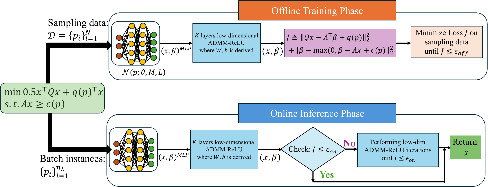
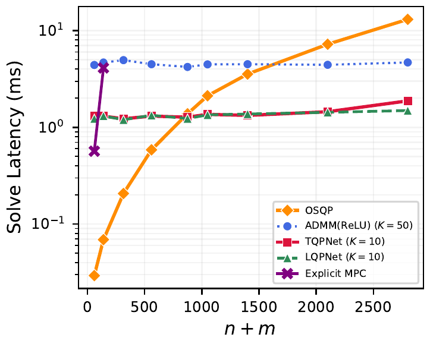

<h1 align="center">TQPNet</h1>

<p align="center">
  <a href="https://neurips.cc/Conferences/2026"></a>
  <a href="https://www.python.org/downloads/"></a>
  <a href="https://github.com/jax-ml/jax"></a>
  <a href="https://pytorch.org/"></a>
  <a href="LICENSE"></a>
</p>

<p align="center"><b>Neural Compression of Long ADMM Trajectory for Multiparametric Quadratic Program</b></p>

<p align="center">Liang Wu<sup>*</sup>, Honghui Zheng<sup>*&dagger;</sup>, Bo Yang<sup>*</sup>, Xu Yang<sup>*</sup>, Yilin Mo, and Ján Drgoňa</p>

<p align="center"><sub><sup>*</sup> Equal contribution &nbsp;·&nbsp; <sup>&dagger;</sup> Corresponding author</sub></p>

<p align="center">Johns Hopkins University &nbsp;·&nbsp; Tsinghua University</p>

Companion code for the paper *Neural Compression of Long ADMM Trajectory for Multiparametric Quadratic Program*, accepted at *NeurIPS 2026*.

---

## The Problem

Model predictive control and learning-enabled systems solve the same quadratic program over and over, with only the parameter vector $p$ changing between calls:

$$
\begin{aligned}
\min_{x \in \mathbb{R}^{n}} \quad & \tfrac{1}{2}\, x^{\top} Q\, x + q(p)^{\top} x \\
\text{s.t.} \quad & A\, x \geq c(p)
\end{aligned}
$$

Solving each instance from scratch with a first-order method such as ADMM can take thousands of iterations. Supervised neural proxies are fast but need solver-generated labels and offer no guarantee on the returned solution. Explicit MPC precomputes the solution map, but the number of regions grows exponentially with problem size.

## TQPNet

TQPNet learns to **compress a long ADMM trajectory** into a compact neural warm start followed by a few refinement iterations, without any solver labels. Three ideas make this work:

1. **Low-dimensional ADMM.** A reduced-state ADMM iterates directly on the primal–dual pair $(x, \beta)$, eliminating the auxiliary variable $z = Ax$. Its per-iteration cost is lower than the standard full-dimensional ADMM and it converges faster in practice.
2. **ADMM(ReLU).** One iteration of this low-dimensional ADMM is exactly a ReLU layer, so it is differentiable and batch-parallel on a GPU.
3. **Self-supervised residual loss.** An MLP(ReLU) maps $p \mapsto (x_0, \beta_0)$ and is trained end-to-end through $K_{\text{train}}$ unrolled ADMM(ReLU) layers on the optimality-condition residual. The same residual serves online as a certificate: if it exceeds a tolerance, a few more ADMM(ReLU) steps refine the answer.

<p align="center">
  
</p>

## Results at a Glance

| Setting | What the paper shows |
|---|---|
| Random mpQPs ($n{=}100$, $m{=}200$) | Cold-start ADMM(ReLU) needs 4729 iterations to reach $10^{-7}$; the learned warm start cuts the inference budget by 1.7–1.8×. Training needs $K_{\text{train}} \geq 25$ unrolled layers to compress; shallower unrolling fails to train. |
| MPC scalability (S0–S8, $n{+}m = 60$–$2800$) | Near-constant solve latency across all scales; faster than OSQP beyond $n{+}m = 875$, reaching a 7× speedup at $n{+}m = 2800$. Explicit MPC already needs 3123 regions and 4.1 ms at $n{+}m = 140$ and is infeasible beyond S2. |
| Quadruped locomotion (Isaac Gym, 4096 robots) | Batch latency stays near constant as the number of parallel environments grows; cost error and constraint violation drop below $10^{-2}$ within $K < 20$ refinement steps, versus $K > 60$ for cold-started ADMM(ReLU). |
| Quadrotor MPC (appendix, $n{=}100$, $m{=}300$) | Closed-loop lemniscate tracking RMSE within about 9% of OSQP and better than cold-started ADMM(ReLU), with bounded per-step latency at fixed $K$. |

<p align="center">
  
</p>

---

## Installation

Requires Python 3.10 or newer.

```bash
git clone https://github.com/SOLARIS-JHU/TQPNet.git
cd TQPNet
pip install -e ".[dev]"           # core JAX package + tests
pip install -e ".[experiments]"   # adds torch, matplotlib, scipy, osqp, cvxpy for experiments/
```

The quadruped benchmarks (`experiments/pympc-quadruped/`) do not use the core package and need `qpth`, which pins `numpy<2` while current JAX releases need `numpy>=2`. Install them in a separate environment without this package:

```bash
pip install "numpy<2" "qpth==0.0.18" torch matplotlib scipy osqp cvxpy
```

See `experiments/pympc-quadruped/README.md` for the simulator dependencies of the closed-loop runs.

## Quick Start

Run the test suite:

```bash
pytest
```

Train a proxy for a small QP family and solve a batch of instances with certification:

```python
import jax
import jax.numpy as jnp
import numpy as np
from tqpnet import Model, box_sampler

# QP family: min 1/2 x'Qx + q(p)'x  s.t.  A x >= c(p),  with fixed Q, A and  q(p) = q0 + Cq p,  c(p) = c0 + Cc p
n, m, n_p = 10, 20, 4
rng = np.random.default_rng(0)
L = rng.normal(size=(n, n)); Q = L @ L.T / n + 0.1 * np.eye(n)
A = rng.uniform(0.0, 3.0, size=(m, n)) * (rng.random((m, n)) < 0.5)
A[np.arange(m), rng.integers(0, n, m)] += 1.0          # every row non-empty
A[rng.integers(0, m, n), np.arange(n)] += 1.0          # every column non-empty
q0, Cq = rng.normal(size=n), 0.3 * rng.normal(size=(n, n_p))
c0, Cc = A @ rng.normal(size=n) - 1.0, 0.1 * rng.normal(size=(m, n_p))

model = Model("demo")
model.set_problem(Q, A, q_fn=lambda p: q0 + Cq @ p, c_fn=lambda p: c0 + Cc @ p)
model.set_sampler(box_sampler(lo=-np.ones(n_p), hi=np.ones(n_p)))
model.Params.Train.n_train, model.Params.Train.epochs, model.Params.Train.K_train = 2000, 300, 10
model.train()

P = jax.random.uniform(jax.random.PRNGKey(1), (8, n_p), minval=-1.0, maxval=1.0)
result = model.solve(P)
print(result.x.shape, int(result.certified.sum()), int(result.refined.sum()), result.steps)
print(float(result.max_violation.max()))
```

`model.solve` runs the MLP(ReLU) warm start through `K_infer` ADMM(ReLU) layers (default: the `K_train` used in training), computes the paper's residual certificate, and keeps refining only the instances whose certificate exceeds `tol_on`, up to `K_max` extra layers. The result reports the certificate, whether each instance is certified, the actual constraint violation, the number of layers used and whether refinement was triggered. `certified` is the paper's residual test: it bounds each constraint violation only by about √(m·tol_on), so check `max_violation` when feasibility matters. Hyperparameters live in `model.Params.Network`, `model.Params.Train` and `model.Params.Solve`, with defaults matching the paper's experiments. Q and A are fixed per problem family (the paper's Eq. 1); only q(p) and c(p) vary with the parameter.

## Reproducing the Paper

Every figure and table maps to a script under `experiments/`; the figure-by-figure guide is in [`experiments/README.md`](experiments/README.md). No trained weights ship with this repository: each experiment trains its own model from scratch with fixed seeds.

| Paper result | Entry point |
|---|---|
| Fig. 2, low- vs full-dimensional ADMM convergence | `python -m experiments.admm.admm_convergence` |
| Fig. 3 and ablation table, $K_{\text{train}}$ study | `python -m experiments.ablation.training_ablation`, `python -m experiments.ablation.inference_ablation` |
| Fig. 4, generalizability under distribution shift | `python -m experiments.generalizability.generalizability` |
| Fig. 5 and MPC table, scalability S0–S8 | `python -m experiments.scalability.scalability_mpc` |
| Figs. 6 and 7, quadruped batch MPC | `experiments/pympc-quadruped/scripts/` |
| Appendix, quadrotor MPC | `python -m experiments.uav.uav_tqpnet` |

## Repository Structure

```
TQPNet/
├── src/tqpnet/               # Core JAX package (import name: tqpnet)
│   ├── model.py              # Model: set_problem / set_sampler / train / solve
│   ├── network.py            # MLP(ReLU) warm-start network
│   ├── admm.py               # Low-dimensional ADMM(ReLU) layer, residual, unrolled loss
│   ├── train.py              # Offline training (Algorithm 2)
│   ├── solve.py              # Certified online solve with triggered refinement
│   ├── sampler.py            # Box parameter sampler
│   └── params.py             # Hyperparameter dataclasses
├── experiments/              # Paper experiments (PyTorch)
│   ├── admm/                 # ADMM convergence (Fig. 2)
│   ├── ablation/             # K_train ablations (Fig. 3, appendix)
│   ├── generalizability/     # Distribution-shift study (Fig. 4)
│   ├── scalability/          # MPC scalability + explicit-MPC baseline (Fig. 5)
│   ├── uav/                  # Quadrotor MPC (appendix)
│   └── pympc-quadruped/      # Quadruped batch-MPC stack (Figs. 6, 7)
├── tests/                    # Unit tests for the core package
├── docs/figures/             # README figures
└── pyproject.toml
```

---

## Citation

If you use this code in your research, please cite the paper:

```bibtex
@inproceedings{wu2026neural,
  title     = {Neural Compression of Long {ADMM} Trajectory for Multiparametric Quadratic Program},
  author    = {Wu, Liang and Zheng, Honghui and Yang, Bo and Yang, Xu and Mo, Yilin and Drgo{\v{n}}a, J{\'a}n},
  booktitle = {Advances in Neural Information Processing Systems},
  year      = {2026}
}
```

## License

Apache-2.0. See the [LICENSE](LICENSE) file. Third-party components in `experiments/pympc-quadruped/` retain their original licenses (see `experiments/pympc-quadruped/LICENSE` and `robot/a1/a1_license.txt`).

## Contact

For questions or issues, open an issue on this repository or email [hzheng39@jh.edu](mailto:hzheng39@jh.edu).

## Acknowledgments

This research was supported by the [Ralph O'Connor Sustainable Energy Institute](https://energyinstitute.jhu.edu/) at Johns Hopkins University, and by the U.S. DOE Office of Science, ASCR program under the Scientific Discovery through Advanced Computing (SciDAC) Institute "LEADS: LEarning-Accelerated Domain Science."

Built on [JAX](https://github.com/jax-ml/jax), [Flax](https://github.com/google/flax), [Optax](https://github.com/google-deepmind/optax), [PyTorch](https://pytorch.org/) and [OSQP](https://osqp.org/).
